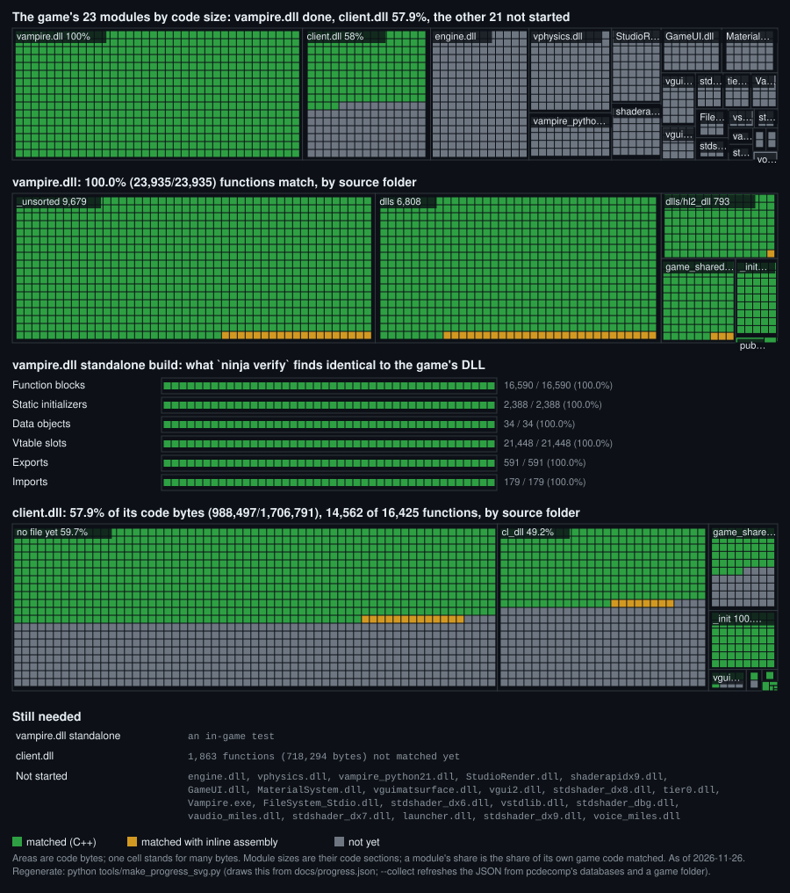

# Vampire: The Masquerade – Bloodlines: `vampire.dll` decompilation

This repository rebuilds `vampire.dll`, the game-code DLL of *Vampire: The Masquerade – Bloodlines* (Troika Games,
2004, patch 1.2), from C++ source. Every function in it matches the original: compiled with Microsoft Visual C++ 6.0
and the game's own flags (`/O2 /GR`), the source produces the same machine code, byte for byte.

The whole DLL comes back the same way. `ninja identical` lays the compiled objects out exactly as the original link
did and writes a `vampire.dll` with the same SHA-1 as the patch 1.2 original:

```
3fe64bc0d9d7eca64976adc668617ca2814e5e4a  build/identical/vampire.dll
3fe64bc0d9d7eca64976adc668617ca2814e5e4a  orig/vampire.dll
```

The matching itself was done with an internal tool (pcdecomp) that is not released, and nothing in this repository
needs it. It compiles one function at a time with the original compiler, compares the result with the game's bytes
and keeps the source only when the two agree. The functions came from three sources: AI agents working through that
tool, hand work, and its automatic passes (machine drafts and copies of twin functions that had already matched).

## Stage 1: the bytes first, readability later

The project is in its first stage. The only aim of this stage is source that compiles to the game's exact machine
code, and that aim decides how the code is written. It is not yet code meant to be read:

- Many functions, globals and virtual slots still carry placeholder names made from their addresses or positions
  (`sub_101c5f40`, `g_1070b22c`, `vfunc192`). The DLL does not say what they are called, and a name is only given
  when there is evidence for it.
- Classes are often seen through small view structs that declare only the members one function needs, at the
  offsets the game uses, instead of one full class definition.
- Some sources contain things that are there only because they make VC6 produce the game's instructions: an extra
  local, a dead `if (0)` block, a constant spelled one particular way. They look like noise, but removing them breaks
  the match.

Readability is the second stage. Once the important parts of the game are matched, the code will be refactored into
a form people can read and work with: real names taken from the game's strings and the Source SDK, complete class
definitions in place of the views, and cleaned-up functions. Every step of that work goes through the same checks as
today (`ninja verify` and `ninja identical`), so the readable source will still build the original DLL byte for byte.

## Status (2026-11-26)



### `vampire.dll`: complete

| | Functions | Code bytes |
|---|---:|---:|
| Game code, matched as C++ | 23,800 (99.44%) | 2,958,007 (97.00%) |
| Game code, matched with inline assembly (counted apart) | 135 (0.56%) | 91,418 (3.00%) |
| **Total game code** | **23,935 (100%)** | **3,049,425 (100%)** |

Not counted above are 17,503 entries that are not the game's own code: 16,468 incremental-link jump stubs and 1,035
C runtime and helper routines (143,448 bytes together).

`src/` holds 18,978 written blocks, 16,590 functions and 2,388 static initializers. The remaining 4,957 matched
functions (103,058 bytes) are generated by the compiler from those blocks for static initialization: 2,389 construct
functions, 1,117 `atexit` registrations, 1,117 destroy functions, 333 destroys of function-local statics and one
initializer entry. Each of them matched as part of the block it belongs to.

Data lives in the sources too. Initialized and constant data is in `src/_data/`, zero-initialized globals in
`src/_bss/`, and static initializers in `src/_init/`.

### Three ways to link it

| Build | Command | Result |
|---|---|---|
| Hybrid | (internal tool) | The original DLL with the compiled functions linked in. Loads and plays in the game. |
| Standalone | `ninja` | A new `build/vampire.dll` linked by VC6's `link.exe`. Same program, different file layout. |
| Identical | `ninja identical` | `build/identical/vampire.dll`, the original file byte for byte. |

The standalone build was played in the game on 2026-11-23 in place of the original: a map loaded, and 150 seconds
of play (two Hollywood areas, a save, the pause menu) went by without a crash. `ninja verify` checks it against the
original. All 16,590 function blocks, 2,388 static initializers and 34 data objects are identical, and the 282
vtables (21,448 slots, every one filled by the compiler), 591 exports (32 SafeDisc data tables among them) and 179
imports all check out. No difference is excused either: since 2026-11-23 `config/known_differences.txt` and
`config/vtable_patches.txt` are both empty.

What `link.exe` does not reproduce is the layout: where each function and table sits, and the padding between them.
The identical build takes care of that (see [below](#building-a-byte-identical-dll)). In its output every byte has
an owner. It is either part of a compiled block, a section of VC6's own runtime libraries, or a part generated by
rule: the jump-stub table, the padding, `.idata`, the exports, `.reloc` and the headers.

### The rest of the game

| Part | State |
|---|---|
| `client.dll` (client game code) | In progress in a separate project: 14,079 of 16,036 functions (87.8%), 862,481 of 1,690,709 code bytes (51.0%) as of 2026-11-26 |
| `GameUI.dll`, `vampire_python21.dll` | Not started |
| Engine and its modules (`engine.dll`, `launcher.dll`, `materialsystem.dll`, `studiorender.dll`, `shaderapidx9.dll`, `stdshader_*.dll`, `vgui2.dll`, `vguimatsurface.dll`, `vphysics.dll`, `vstdlib.dll`, `tier0.dll`, `filesystem_stdio.dll`, `vaudio_miles.dll`, `voice_miles.dll`), `Vampire.exe` | Not started |
| Third-party libraries (Miles, Bink, zlib, Microsoft runtime) | Out of scope |

The chart is drawn by `tools/make_progress_svg.py` from `docs/progress.json`. Run it as is to redraw the chart; with
`--collect --client <client project> --game <game folder>` it first re-reads the numbers from the internal tool's
databases and the game's files, so that option only works where the tool ran.

## What is in this repository

| Path | Contents |
|---|---|
| `src/` | The matched functions, grouped into the game's source files. File names come from the DLL's own strings or are guessed from the Source SDK's server project (each file's header says which); functions with no known file are grouped by class in `src/_unsorted/`. Also the data templates, globals and static initializers |
| `include/` | Shared headers: the game's classes, recovered from its RTTI, vtables and code |
| `configure.py`, `tools/` | The build. It writes `build.ninja`, runs VC6, fixes up and links the objects, verifies the result and lays out the byte-identical DLL ([how it works](docs/building.md)) |
| `config/` | Tables the build reads: block list, aliases, fix-ups, `.bss` layout, import lists, known differences, and the original's layout (`config/layout/`) |
| `orig/` | Where your own `vampire.dll` goes (git-ignored) |
| `symbols.txt` | Every address with its symbol name |
| `project.toml` | Settings of the internal matching tool (compiler flags, prelude, agent settings); the build does not need it |
| `docs/` | How the build works ([building.md](docs/building.md)), plus research notes on VC6 register allocation and the standalone link |
| `CLAUDE.md` | The working guide the agents followed: the VC6 code-generation idioms that decide a match |
| `phase0/` | The first experiments, which tested whether matching was possible at all |
| `LICENSE` | CC0 1.0 Universal (see [License](#license-cc0-10)) |

**No game files are included.** To build or check anything you need your own legally obtained copy of the game, namely
`vampire.dll` from patch 1.2 (SHA-1 `3fe64bc0d9d7eca64976adc668617ca2814e5e4a`), and Visual C++ 6.0. The game was
built with VC6 build 9044. The build needs nothing else; the matching tool's own database and cache are not part of
the repository.

## Building

Requirements:
- Windows
- Python 3.11 or later
- ninja (`pip install ninja`, or any ninja on PATH)
- Visual C++ 6.0 with the Processor Pack (its `ml.exe` 6.15 assembles the data templates)
- your own `vampire.dll` from patch 1.2, found in the game's `Vampire\dlls\` folder

```
git clone https://github.com/otonomy/vampire-decomp.git
cd vampire-decomp
copy "<game folder>\Vampire\dlls\vampire.dll" orig\
python configure.py --vc6 "C:\Program Files (x86)\Microsoft Visual Studio"
ninja
ninja verify
```

A few notes:
- Keep the clone's path under about 80 characters. Some file names in `src/_unsorted/` run to 173 characters,
  Windows caps a full path at 260, and git stops with "Filename too long" when the folder path is longer.
- `--vc6` is the folder that contains `VC98` (with `VC98\BIN\CL.EXE`). Without it, `configure.py` tries `%VC6_DIR%`
  and then the installer's default locations.
- `--orig FILE` uses a copy of `vampire.dll` stored elsewhere instead of `orig\vampire.dll`.
- `ninja` writes `build\vampire.dll` and `build\vampire.map`. The first build compiles about 19,000 objects, which
  takes around 20 minutes on 12 threads. After that only what changed is recompiled, including every block that
  includes a changed header.
- [docs/building.md](docs/building.md) walks through each step and each file in `config/`.

## Verifying

`ninja verify` compares `build\vampire.dll` with your `orig\vampire.dll`. It checks:
- every function block, initializer and data object byte for byte, with each relocation pointing at the counterpart
  of the game's target, including the data a block defines (RTTI records, tables, statics);
- every vtable slot;
- the static-initializer table, the exports and the imports;
- that every block in `src/` is listed in `config/blocks.txt` (an unlisted block is built but never checked).

It prints a summary and writes `build\report.json`. The exit code is 0 only when every difference it finds is listed
with a reason in `config/known_differences.txt`. That list is empty today, so any difference fails the check. To look
at one function, `python -m tools.verify --function 0x<address>` prints its bytes next to the game's, disassembled if
`capstone` is installed (`pip install capstone`).

`ninja ownership` assigns every byte of `orig\vampire.dll` to an owner (code, data, vtables, library code, linker
tables, padding and so on), writes `build\ownership.json`, and exits 1 as long as any byte is left without one.

## Building a byte-identical DLL

```
ninja identical
```

A normal `ninja` build leaves the layout to `link.exe`, which packs functions its own way. The original was produced
by an incremental link: each function sits in a slot with padding after it, calls go through a table of jump stubs,
and `.idata` is a section of its own. `ninja identical` rebuilds that layout from the same objects. Its linker,
`tools/layout.py`, places every function block, data object, library section, jump stub and import thunk at its
original address and applies the relocations itself. It also generates the stub table, the padding, `.idata`, the
export and debug directories, `.reloc` and the DOS, Rich and PE headers.

The result goes to `build\identical\vampire.dll`. The command exits 0 only if that file's SHA-1 equals the one
recorded in `config/build.toml`. If it does not, it reports for each section how many bytes agree and where the first
differences are, along with what owns those bytes.

Things to know:
- The layout comes from the tables in `config/layout/` (sections, stubs, thunks, imports, exports, libraries). They
  hold addresses, names, orders and sizes, never game bytes. As in the normal build, the data templates take their
  bytes from your own `orig\vampire.dll`.
- It reproduces the sources as they are. If a changed function no longer fits in the slot the game gave it, the
  build stops with an error naming it. Use plain `ninja` for modified code.
- It is a separate target: plain `ninja` does not build it. `ninja identical` compiles the objects first if needed.

## Legal

This is an unofficial fan project for study and preservation, not affiliated with or endorsed by the owners of the
game. *Vampire: The Masquerade – Bloodlines* was developed by Troika Games and published by Activision.
*Vampire: The Masquerade* and *World of Darkness* are trademarks of Paradox Interactive. The game runs on Valve's
Source engine. No game assets or binaries are distributed here.

### License: CC0 1.0

The contributors dedicate their own work in this repository to the public domain under CC0 1.0 Universal (full
text in `LICENSE`). You may use, change and share that work for any purpose, without asking and without giving credit.
By opening a pull request you dedicate your contribution under the same terms.

The dedication covers only the contributors' own work. It grants no rights in the game, its code, its data or its
assets, in the Source engine, or in any trademark; those remain with their owners. Building or checking anything here
requires your own legally obtained copy of the game. If a rights holder asks for material to be removed, open an issue
and it will be taken down.
